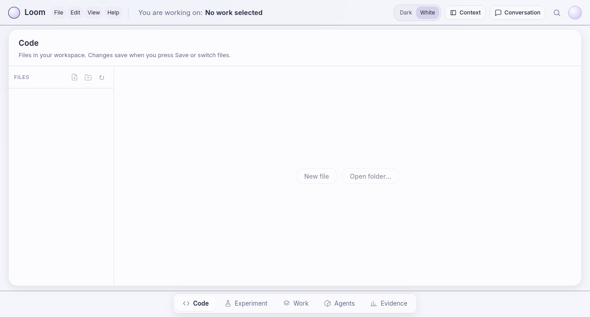
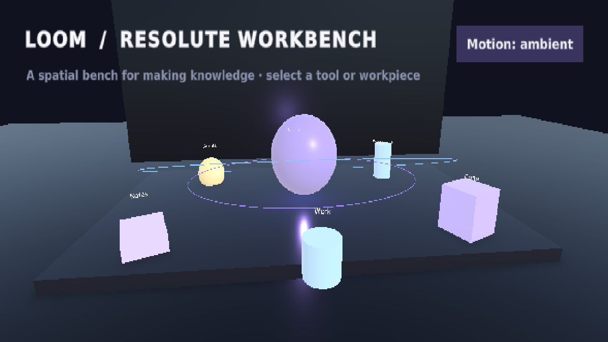

# Loom — Living Workbench + Human-Centered Development Environment

A hobby project merging **Living Workbench's visual workspace**, the
**Human-Centered Development Environment's work and file tools**, and a new
**Unity spatial workbench**. The goal is to preserve what we like about each and
bring them together into one evolving experience.

All three surfaces are active and live in this repository:

| Interface | Source | What it contributes |
|---|---|---|
| Living Workbench | `native-app/` — Rust, eframe/egui | Sphere, Dark/White appearance, conversation, knowledge graph, local notes, review bell, Canvas and bottom navigation |
| Human-Centered Development Environment | `src/` + `src-tauri/` — TypeScript/CSS, Rust, Tauri 2 | File/Edit/View/Help menus, workspace files and editing, structured work/intents, sessions, agents, workflows and artifacts |
| Resolute Spatial Workbench | `unity-memory-palace/` — Unity 6, URP, C# | A game-like workbench with ambient movement, spatial tools/workpieces and memories stored on objects |

**The merge is ongoing.** Tauri and Living Workbench have normal application
windows; the Unity surface is a source-driven prototype with a verified local
Linux player build. The three surfaces still have separate local state and some partial Loom integrations. Shared
appearance and read-only record discovery do not imply a unified database or
agent runtime.

## Latest additions and modifications

- **Resolute Spatial Workbench:** a Unity 6 URP project now lives inside this
  repository. Its first scene treats Loom as a carpenter's bench for making
  knowledge: a central sphere, orbiting tools/workpieces for Work, Code,
  Experiments, Evidence, Agents and Notes, pointer parallax, scroll travel,
  hover/selection feedback and an ambient/reduced-motion switch. Selected
  objects can retain a short local memory. Work and Experiment objects read the
  current saved Tauri record counts without changing those files.

- **Shared Dark/White appearance:** both interfaces read `design-tokens.json`.
  Lavender/blue accents, semantic colors, 12px control radii and 20px panel radii
  replace the earlier cream-only Tauri palette. Each interface remembers its own
  appearance preference.
- **One primary navigation bar in Tauri:** the duplicated icon rail was removed.
  Code, Experiment, Work, Agents and Evidence remain in the bottom bar.
- **Navigation between applications:** Workbench's **File → Go to Tauri
  environment** and Tauri's **View → Living Workbench** restore/focus an existing
  instance. They start the other application only when it is closed. Both
  executables must have been built in this repository.
- **Workbench file tools:** File/View menus, folder browsing, file/folder creation,
  a text editor and explicit Save. It reads Tauri's selected workspace folder on
  startup; unsaved drafts block file switching, and external edits block an
  overwrite.
- **Workbench's View → Work:** a read-only view of the same saved Tauri work,
  intents and experiments, with Refresh and full-record inspection.
- **Cleaner Work detail in Tauri:** one selected work item instead of a duplicate
  catalogue, with title, state, local planning controls, criteria, artifacts and
  evidence. Conversation and Context share one supporting pane.
- **Conversation starts empty:** the preset summary and example exchange were
  removed. Workbench no longer generates canned offline research replies; an
  unavailable Loom server leaves the draft intact and reports the error.
- **Frontend cleanup:** sample badges, the empty Collaboration panel, native
  context-pack preview and demonstration experiment controls were removed.
  Unused frontend bridges for traces, model switching, artifact contents and
  artifact search were removed; their Rust implementations remain.
- **Actual vault content:** new Workbench vaults start empty. Historical sample
  records are filtered from normal views without deleting their files. Canvas
  renders actual notes and relationships, supports inspection/dragging and exports
  JSON Canvas. **Activity** replaces the static remote-Traces placeholder with the
  working local journal.

The [Loom connection audit](docs/LOOM_CONNECTION_AUDIT.md) records the pre-cleanup
findings. The [frontend cleanup notes](docs/FRONTEND_CLEANUP.md) describe what was
subsequently removed and preserved.

## Current screenshots






Other screenshots in `docs/` include historical designs and isolated test states.
They do not all represent the current application. The render-check JSON files
record actual viewport dimensions, which take precedence over filenames.

## What works and where it lives

### Living Workbench

- **Home:** sphere, active-intent editing, conversation, appearance selector and
  the review bell. The sphere reflects local UI state, not remote agent telemetry.
- **Knowledge:** local notes, folder filters, search, typed relationships,
  backlinks, editing/history and a graph of visible notes.
- **Canvas:** real vault notes and links, draggable cards, note inspection and
  JSON Canvas export. Card positions are held in memory.
- **Experiments and Decisions:** local records you create; the former strategy
  demonstration is no longer exposed.
- **Memory garden / bell:** local proposed-note review. It is not a Loom
  human-in-the-loop approval inbox.
- **Activity:** the vault's edits, links and review journal; no invented remote
  executions or cost/latency metrics.
- **Files and Work:** file tools and the shared-file work overview described above.
- **More → Scene preview:** local sphere transform/playback controls and saved
  presets. This native preview remains independent from the Unity scene.
- **Loom chat and Sync from Loom:** chat submits a real query; sync imports new
  sessions, agents and artifact metadata as local notes. Existing imported IDs
  are skipped; this is not bidirectional synchronization.

See [the Workbench README](native-app/README.md) for vault and preview details.

### Resolute Spatial Workbench (Unity)

- **ResoluteWorkbench scene:** a spatial interpretation of the workbench, not a
  separate source of truth. Runtime geometry is deliberately generated from one
  controller while the interaction language is still evolving.
- **Meaningful movement:** the sphere breathes, workpieces float/rotate and the
  camera responds gently to the pointer. Reduced motion stops travel, floating
  and rotation rather than merely shortening them.
- **Interactive objects:** clicking a workpiece opens its role and a local text
  area. **Keep at bench** persists that note through Unity PlayerPrefs.
- **Existing Loom records:** the Work and Experiments descriptions report counts
  from Tauri's existing JSON stores. Unity reads them defensively and never
  writes, migrates or repairs them.
- **Palette:** the scene uses the current dark values from
  `design-tokens.json`; a Unity-side self-check verifies its key colors.

See [the Unity workbench README](unity-memory-palace/README.md) for controls and
verification commands.

### Tauri environment

- **Code:** local workspace files, nested folders, create/open/edit/save/reload,
  with external-change protection. No file opens automatically. **Ask Loom about
  this** sends the first 280 characters of the editor text to chat.
- **Work:** local intents, work items, acceptance/success criteria, planning
  preferences, session links and artifact attachments. The catalogue remains in
  the left pane; the center shows the selected item. **Mark paused** changes a
  local work state, not a running agent.
- **Experiment:** local questions, hypotheses and arms. Run arm sends a real Loom
  weave prompt and stores the reply. This is not an independent benchmark or a
  guarantee that configuration prose was enforced. You can compare saved replies
  and record/change a decision.
- **Agents and sessions:** real server listings, selection, session creation,
  conversation history and detail views when Loom is available.
- **Workflows and artifacts:** browse/run workflows, poll execution results, browse
  artifact metadata and attach artifact IDs to work. Dismiss stops local tracking;
  it does not cancel a server run.
- **Evidence:** recorded experiment choices and readable workflow outputs. It is
  a read-only summary feed, not a verification chain. Work-specific associations
  are currently in-memory and do not survive a restart.
- **Context:** local experiment decisions awaiting attention, plus server session,
  agent, tool, model/provider, configuration, storage and artifact statistics when
  available. The unsupported Collaboration section is no longer present.

The shell has header/main/footer rows and intentional scroll regions. At 1440px
and above the supporting pane can be inline; below that it becomes a drawer.
Below 1100px the work catalogue also becomes a drawer. Drawers support Escape,
keyboard focus management and return focus to their opener. The sphere and water
atmosphere remain in Experiment, with reduced-motion support.

## Run the workbench surfaces

Run commands from this repository's root, the directory containing `package.json`.
There is no root Cargo project; use the appropriate `--manifest-path`.

Use Node.js 24 (the version used in CI), Rust 1.90+ and the Linux desktop build
libraries. The installed Vite package accepts Node `^20.19.0 || >=22.12.0`.
On Ubuntu, the build libraries include:

```bash
sudo apt install -y build-essential pkg-config libwebkit2gtk-4.1-dev \
  libgtk-3-dev libayatana-appindicator3-dev librsvg2-dev libssl-dev \
  libasound2-dev
```

Build both surfaces, then open Workbench:

```bash
npm ci
cargo build --locked --manifest-path native-app/Cargo.toml
npm run tauri build -- --no-bundle
./native-app/target/debug/living-workbench
```

Use **File → Go to Tauri environment** to navigate to Tauri; return through
**View → Living Workbench**. These links currently locate executables in this
repository's build directories. Packaging both applications together for
standalone installation remains unfinished.

For development, run `npm run tauri dev`. It starts Vite on port 1420 and opens
the desktop window. `npm run dev` starts only the browser preview; do not run a
second Vite instance on the same port. For Tauri installers, run
`npm run tauri build`; bundles go under `src-tauri/target/release/bundle/`.

On Linux with an X display available, both applications use X11/XWayland so
cross-application focus works. Activation uses localhost ports **43761** (Tauri)
and **43762** (Workbench), separately from Loom. Starting another instance focuses
the registered window. After updating an executable, close and reopen that
application once to load its new code.

Open the spatial workbench with the installed Unity CLI and press Play in the
Editor:

```bash
unity open "$PWD/unity-memory-palace"
unity status --until-ready --project-path "$PWD/unity-memory-palace"
```

Build a local Linux player when needed:

```bash
unity build "$PWD/unity-memory-palace" --target StandaloneLinux64 \
  --output "$PWD/unity-memory-palace/Builds/Linux/LoomResoluteWorkbench.x86_64"
```

The first launch may show Unity's software terms, which must be accepted by the
person using the Editor. Unity-generated `Library/`, `Temp/`, logs, builds and
user settings are ignored by Git.

### Connect to Loom

Both adapters currently target `http://localhost:5006`. Start your configured
Loom server separately, for example:

```bash
looms serve --http-port 5006
```

Local editing, notes and planning remain usable offline. Chat, workflow runs and
server-backed listings require Loom. Missing data or failed requests should show
an empty/error state rather than a fabricated result.

The **plain browser preview is limited**: work/intents have browser-local
persistence, and health/chat can use Vite's `/api/loom` proxy. Most other commands,
including real filesystem access, require Tauri.

## Saved data and synchronization boundaries

| Data | Storage / behavior |
|---|---|
| Workbench vault | `native-app/Research Vault/` by default; override with `--vault /absolute/path`. Notes, ledger, history and preferences stay local. |
| Tauri work, intents and experiments | `<app-data>/loom-ide/{work,intents,experiments}.json`. On Linux, normally under `~/.local/share/com.loom.ide/loom-ide/`. |
| Workspace selection | Tauri's `workspace.json`; defaults to `Documents/Loom`. Workbench reads this selection at startup; later folder changes are not synchronized both ways. |
| Workbench Work overview | Reads Tauri's JSON records on load/Refresh. It does not duplicate or migrate them. |
| Tauri chat cache/drafts and appearance | WebView/browser storage; separate from the native vault's preferences and chat state. |
| Loom sessions, agents, workflows and artifacts | Owned by the Loom server; native imports are local snapshots of selected metadata. |
| Unity spatial memories | Unity PlayerPrefs, keyed by workpiece. Unity also reads Tauri's work/experiment JSON counts and never writes those stores. |

Build output, local vaults, test data and tooling caches are ignored by Git.
The published screenshots and audit documents are tracked intentionally.

## Validation

Latest local verification on November 13, 2026:

- Frontend build/type check and **29 Vitest tests passed**.
- Tauri library: **73 tests passed**, one live-gateway test skipped.
- Workbench: **22 tests passed**; native build passed.
- Tauri formatting/check and the repository pre-commit gates passed.
- Graphical Workbench checks covered an empty start, capture/edit/reopen, links,
  Canvas/export, manual draft preservation, themes and scene presets.
- Six cleaned Tauri render states were checked in WebKit. Both sample-badge and
  Collaboration-panel counts were zero; no horizontal page overflow was reported.
- Repeated cross-window activation was checked without changing the registered
  process IDs. Live Loom integration remains unverified while the server is offline.
- Unity 6000.6.9f1 compiled the spatial workbench without warnings. Play Mode
  advanced beyond 400 frames, pointer selection opened a workpiece panel, the
  palette self-check passed, and the read-only bridge found 4 Work records and
  1 Experiment in the current local Tauri store.
- The standalone Linux player built successfully, remained running with the
  scene loaded, and created its stable PlayerPrefs location under
  `Loom/Resolute Workbench`. Generated player files remain ignored.

Run the checks from the root:

```bash
npm run build
npm test
cargo fmt --check --manifest-path src-tauri/Cargo.toml
cargo test --locked --manifest-path src-tauri/Cargo.toml --lib
cargo test --locked --manifest-path native-app/Cargo.toml
cargo build --locked --manifest-path native-app/Cargo.toml
```

The navigation tests need permission to bind localhost sockets. Add `--offline`
to Cargo commands when the locked dependencies are already cached.

For the native graphical self-test (requires a desktop session):

```bash
mkdir -p native-app/test-data
./native-app/target/debug/living-workbench \
  --self-test "$PWD/native-app/test-data/self-test.json"
```

This creates an isolated test vault and writes a report and screenshot. It does
not use historical starter records. Capture/self-test runs are separate from the
normal single-instance window.

Enable the existing hook with `git config core.hooksPath .githooks`. It checks the
frontend build and Tauri formatting/check when relevant files change. GitHub CI
currently runs frontend and Tauri backend jobs; **native-app tests are manual**.
A checked-in full end-to-end UI suite is still missing.

To run the optional read-only gateway smoke test against a running server:

```bash
cargo test --locked --manifest-path src-tauri/Cargo.toml --lib \
  gateway_tests::live_gateway_responses_parse -- --ignored --exact
```

## Known limits and next integration work

- Workbench chat sends the typed query but does not transmit the prepared vault
  context or retain a Loom session/agent identity. Its displayed transcript is
  in memory, and its network requests currently block the UI thread.
- Workbench sync imports new IDs only; updates, deletions and two-way edits are
  not synchronized. Response-field compatibility needs live validation.
- Planning preferences, work state, criteria and local note approval do not
  enforce server execution policies or answer Loom HITL requests.
- Evidence has no linked trace/source inspection or independent evaluation.
  Generated output must not be treated as proof of its claims.
- There is no frontend model-switch, artifact-content/search or trace-detail
  action. Their unused frontend bridges were removed; Rust HTTP commands remain.
- Remote GraphMemory, MCP management/panels, streaming progress and server
  pause/resume/cancel controls are not connected through these interfaces.
- The two data models remain separate. Theme/window integration is not a data
  migration, and a shared local folder is not automatic model context.
- Unity is not yet embedded into the Tauri window or packaged as a player. It
  reads only Work/Experiment counts; object memories are still Unity-local, and
  there is no bidirectional spatial editing bridge.

## Project layout

```text
loom-ide-tauri/
├── README.md
├── design-tokens.json           # shared Dark/White colors and radii
├── index.html                   # Tauri web shell, panes and dialogs
├── src/                         # TypeScript/CSS UI, API wrappers and tests
├── src-tauri/                   # Rust/Tauri commands, stores and Loom HTTP client
├── native-app/                  # active Rust/eframe Living Workbench
│   ├── src/                     # vault, graph, Canvas, files, work overview, chat
│   └── README.md
├── unity-memory-palace/         # Unity 6 URP Resolute Spatial Workbench
│   ├── Assets/Loom/             # runtime interaction and palette logic
│   ├── Assets/Scenes/           # ResoluteWorkbench scene
│   └── README.md
├── shared/navigation.rs         # single-instance activation for both apps
├── docs/                        # design history, connection audit, cleanup, captures
└── .github/workflows/ci.yml
```

The older Obsidian-style build prompt is retained as
[historical design material](docs/05-craft-anything-build-prompt.md). It does not
replace the active three-surface architecture described here.

## License

Prototype — no repository-wide license chosen yet. The native package metadata
and bundled-font notices are documented alongside that project.
