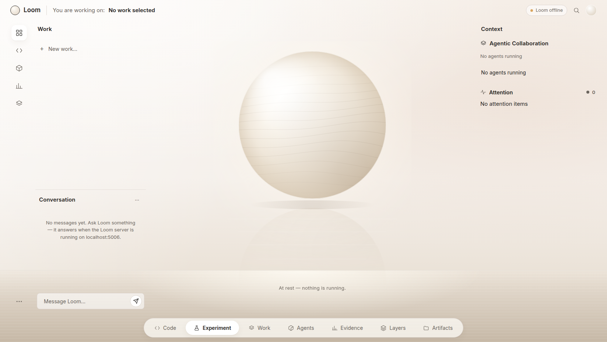
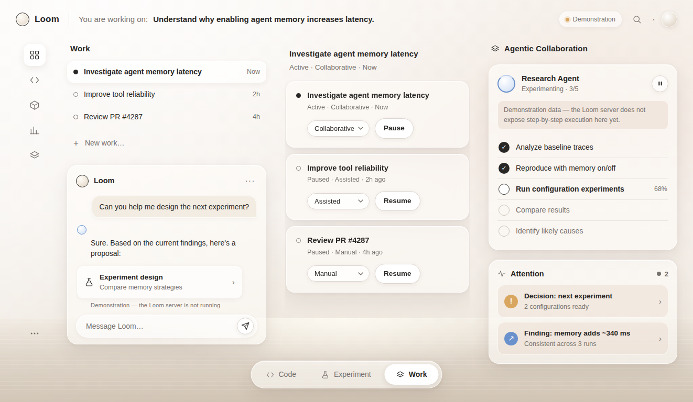
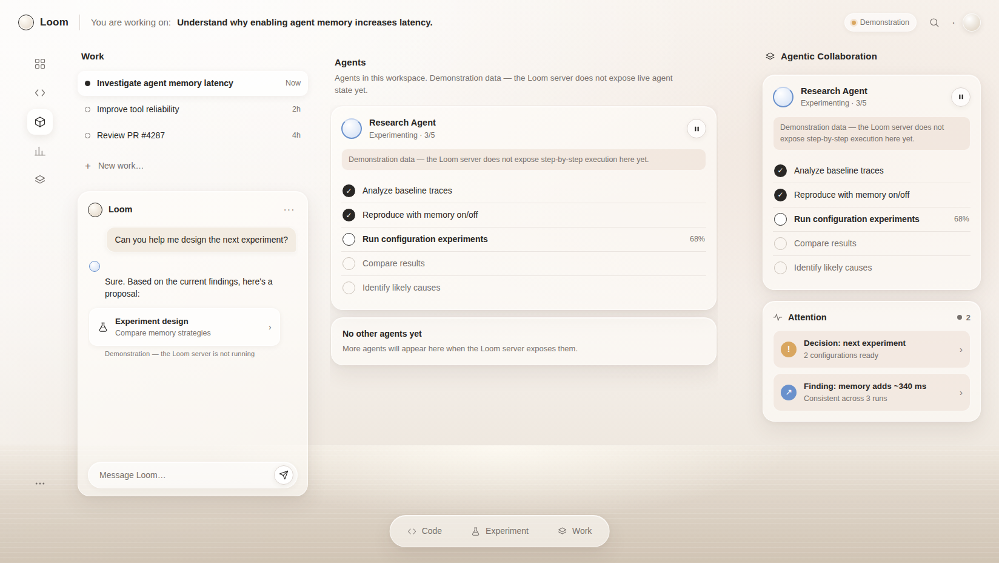

# Loom IDE — Tauri prototype

A human-centered, AI-native development environment built on the Loom
agentic platform. This is the **Tauri 2 prototype**: a Rust backend with
a web frontend, built to reproduce the light minimal design reference —
warm beige palette, glass translucent panels, soft shadows, lots of
whitespace.

> Design reference: `Agent_Memory_Experiment_Dashboard_1.png` (light
> minimal dashboard). The heart of the design is the cleanliness and
> transparency of the elements; the glowing sphere is nice but secondary.







## The shell

Three rows, no absolute positioning:

- **Header (~56px)** — current objective, Work, Context, and Conversation toggles,
  a search input that filters the work list, and the Loom status pill.
- **Main (flexible)** — icon rail (48px), work catalogue (~260px)
  with the Conversation available on demand below the work list, center floor
  (min ~520px), right inspector (~280px, Context only).
- **Footer (~56px)** — the mode switcher, in normal flow:
  **Experiment · Work · Code · Agents · Evidence · Layers · Artifacts**.

Every long region has its own scroll owner; mode headings stay outside
scrolling bodies and never clip.

**Breakpoints.** ≥ ~1440px shows all panes. ~1100–1439px collapses
the right inspector behind the labeled **Context** toggle. < ~1100px
also moves the left catalogue behind the **Work** toggle. The
Conversation is not a drawer or a tab: it lives in the left column
directly below the work list, opened on demand with the
**Conversation** toggle in the header and closed by default, in every
mode, at every width. Below ~1100px it travels with the left drawer,
so opening it there opens the drawer too.
An unsent message is saved as you type, so it survives closing the
drawer and restarting the app. Drawers close with Escape and return
focus to the control that opened them. Drawers span only the main
row — they never cover the header or the footer.

**Depth, not transparency.** The window is opaque — the desktop never
shows through. The sense of 3D comes from layering: a painted warm
backdrop with a light beam, translucent glass panels floating above it,
and one restrained shadow separating the layers. The water reflection
is kept as background atmosphere in **Experiment** overview only; in
Work and Code modes the background behind reading surfaces is flatter,
so text stays easy to read. (An earlier build made the window itself
transparent; that was a misunderstanding and was reverted.)

## Modes and how to reach them

- **Experiment** — a list + detail view: question, hypothesis, arms,
  Run-arm (real weave calls against the Loom server), results, and a
  decision card once ≥2 arms are done. The luminous sphere (canvas 2D:
  radial gradients + fine flowing contour lines + water reflection)
  is a compact state indicator in the sidebar, states idle /
  listening / processing / executing / attention / completed, with a
  caption in plain words. The sphere animation pauses when its view is
  hidden.
- **Work** — the left panel is the work catalogue; the center is the
  selected work's detail view: full title and state, a control row for
  the planning preference and the supported local action, goal,
  editable success criteria (add/remove, persisted), a Workflows
  section (list + Run + recent executions), artifacts with
  Attach/Detach, and evidence from experiment decisions.
- **Code** — a plain notes editor (design philosophy note + scratch
  notes, saved locally, both starting empty) plus the workspace
  explorer: a read-only tree over the Loom workspace directory
  (`~/.loom`), click a text file to open it. "Ask about this note"
  sends the note to Loom through the Conversation (opening it first
  if it is closed).
- **Agents** — the agents from `GET /v1/agents`: name, status dot,
  uptime, active sessions, message count. Empty ("No agents running")
  only when the server reports none.
- **Evidence** — what the claims rest on: experiment decisions made in
  this workspace. Empty ("No evidence yet") until a decision is made.
  The Loom server exposes no findings/traces API, so there is nothing
  else to show yet.
- **Layers** — toggles for the scene layers: light beam, water
  reflection, glass panels, sphere.
- **Artifacts** (footer mode, and the rail's ··· menu) — two tabs:
  **Artifacts** (the artifacts fetched from the Loom server, with the
  work's session filter in Work detail) and **Documents** (the two
  local notes; clicking one opens it in Code mode).

Both navigation mechanisms — the icon rail and the footer mode
switcher — show the same current destination.

## What it is

- **Backend (Rust, `src-tauri/`)** — Tauri 2 commands (36):
  - Work: `get_work_items` / `add_work_item` / `set_work_status` /
    `set_work_autonomy` / `set_work_session` /
    `set_work_success_criteria` / `set_work_artifacts` — work items
    persist as structured JSON in `<app-data>/loom-ide/work.json`,
    like the existing eframe app. The store starts empty; work items
    come from the user creating them. Saves are atomic (temp file +
    fsync + rename); a corrupt file is moved aside, never overwritten.
  - Intents: `get_intents` / `create_intent` / `update_intent` /
    `set_intent_acceptance` / `set_active_intent` / `delete_intent` —
    an Intent is what the person wants, why, what "done" means
    (acceptance checklist), and how much freedom the system has.
    Persisted in `<app-data>/loom-ide/intents.json` with the same
    atomic-save and corrupt-file protection as work items. One intent
    owns many work items; the active intent is pinned at the top of
    the workspace. No work exists without an intent: creating work
    with no active intent auto-creates a one-line intent from its
    title. Work inherits its intent's autonomy, and a work item's
    autonomy can never be raised above its intent's level. Editing an
    intent's statement, why, or autonomy bumps its version and keeps
    the previous version in history; ticking acceptance criteria does
    not bump the version. An intent with work attached cannot be
    deleted until that work is moved or removed.
  - Experiments: `get_experiments` / `add_experiment` /
    `add_experiment_arm` / `set_experiment_arm_status` /
    `set_experiment_arm_result` / `choose_experiment_arm` /
    `clear_experiment_decision` — persisted in
    `<app-data>/loom-ide/experiments.json`. Arms run as real weave
    calls; a decision requires a finished arm with a real result.
  - `get_collaboration` — empty until the Loom server exposes live
    execution state. `get_attention` — experiment decisions waiting
    on the human (≥2 arms done, no winner picked yet).
  - `get_loom_status` — the real component check, `GET /v1/health`
    against localhost:5006 (async, via the raw HTTP client below).
    The plain `/health` route is a static stub and is not used.
  - Sessions/agents/chat: `list_sessions` / `create_session` /
    `list_agents` / `get_session_history` / `ask_loom` — a real
    `POST /v1/weave` on `http://localhost:5006` with `{"query": ...}`.
    The Rust HTTP client reads framing explicitly, including chunked
    responses from gRPC-gateway. The gateway encodes 64-bit integers
    as JSON strings; the backend parses them tolerantly. When the
    server cannot be reached, or answers without usable text, the
    command fails and the UI shows the error. Nothing invents a reply.
  - Workflows/artifacts: `list_workflows` / `execute_workflow` /
    `get_workflow_execution` / `list_workflow_executions` /
    `list_artifacts` (optionally scoped to one session). Workflow
    runs are blocking; the execute response's `result` is surfaced as
    evidence. Executions carry no work id on the server, so the list
    is workspace-global.
  - Workspace explorer: `list_workspace` / `list_directory` /
    `read_file` — read-only over the Loom workspace directory
    (`~/.loom`), canonicalized and contained; dotfiles skipped,
    1 MB read cap.
- **Frontend (Vite + TypeScript, `src/`)** — no framework: plain
  TypeScript + CSS, chosen deliberately because the UI is a static,
  design-driven layout and hand-written DOM/CSS gives the closest
  control over the glass/transparency look with the smallest bundle.
  In `vite dev` (plain browser) the Loom calls go through the
  `/api/loom` dev proxy in `vite.config.ts`, which forwards to
  `http://localhost:5006`; work items fall back to localStorage. The
  same no-demo rule applies there: a failed call is an error, not a
  made-up reply.

### Truthfulness rules (the UI must not pretend)

- The status pill shows **Loom offline** when the server is not
  reachable, **Server reachable** when the health probe answers, and
  **Connected to Loom** only after a verified Loom-level response.
- There is no seed or demonstration data anywhere in the app. Empty
  states are honest: "No work yet", "No agents running",
  "No attention items", "No evidence yet", "No artifacts yet",
  "No artifacts attached", "No evidence attached",
  "No success criteria recorded."
- The chat starts empty with a short hint. If the Loom server is not
  reachable, the chat shows a connection error ("Could not reach
  Loom: …") and keeps the failed text in the composer for retry. It
  never invents a demo reply.
- Work controls are **local planning labels**: "Planning mode" and
  "Mark paused" / "Mark active" save a preference on this device.
  They do not pause a running agent. Execution controls that the
  server does not expose do not exist yet.
- Progress is stated as "Step 3 of 5" and "2 of 5 completed" — the
  active step is not counted as done.
- Every active control performs its labeled action. A click that
  redirected to an unrelated mode was a defect and was fixed.
- A failed save shows a readable error beside the control; the
  control's previous value is restored.

### Type scale and tokens

- Body 14–15px, secondary 12–13px, section titles 16–18px,
  line height 1.4–1.5, 4px spacing base.
- Palette: app background `#F5F0EB`, text `#292725`, secondary
  `#77716D`, boundary `#DDD5D0`, focus/selection muted blue `#6A91CC`,
  amber `#D9A65F` for decisions.
- Panel radii 12–16px, control radii 6–8px, one restrained panel
  shadow, flat list rows with a quiet selection wash.
- **Window**: 1648×928 by default (the design's fidelity target),
  minimum 1024×640, opaque.

## Before / after (the 2026-11-11 redesign)

Before — the version Eduardo ran and screenshotted:

- The window was transparent, so the desktop showed through the IDE.
- Work mode showed the catalogue twice (left panel and center); the
  center had no detail view of the selected work.
- The mode nav was absolutely positioned over the content with
  104–110px of bottom padding as compensation; headings could clip.
- Work cards truncated titles, repeated the autonomy label, and said
  "Now ago".
- The search button focused the chat input; the agent pause button
  pretended to pause a real agent; a chat card jumped to Experiment;
  a decision only tinted the sphere for 4 seconds.
- The water horizon ran behind reading surfaces in every mode.
- The app shipped seeded work items, seeded collaboration steps and
  attention items, a seeded example chat, seeded notes, and demo
  replies when the server was down.

After — this version:

- Opaque window; depth through layered paint, glass, and shadow.
- Work mode: catalogue left, selected work's detail center.
- Three-row shell; footer mode nav in normal flow; headings never clip.
- Work summary component: title on its own first row, metadata on
  its own line, controls below the text; "Updated now" / "Updated 2h
  ago"; autonomy once, in its labeled planning control.
- Search filters the work list; chat cards open the Artifacts view.
- Water reflection only in Experiment overview; flat warm background
  behind reading surfaces.
- No seeds, no demo replies, no sample labels, no test fixtures in
  the app. Empty states are honest, and a failed Loom call is a
  visible connection error.

## Run it (Ubuntu 24.04)

### 1. System dependencies

```bash
sudo apt update
sudo apt install -y libwebkit2gtk-4.1-dev build-essential curl wget file \
  libxdo-dev libssl-dev libayatana-appindicator3-dev librsvg2-dev \
  libgtk-3-dev pkg-config
```

### 2. Rust (via rustup) and Node.js 20+

```bash
curl --proto '=https' --tlsv1.2 -sSf https://sh.rustup.rs | sh -s -- -y
# then restart your shell, or: source ~/.cargo/env
node --version   # needs 20+
```

### 3. Run the app

```bash
npm install
npm run tauri dev
```

### 4. Build installers (.deb / .AppImage)

```bash
npm run tauri build
# bundles land in src-tauri/target/release/bundle/
```

### Frontend only (no Rust, in a browser)

The UI also runs in a plain browser with local persistence, for quick
visual iteration. The Loom calls go through the `/api/loom` dev proxy
to `http://localhost:5006`; start the Loom server first
(`looms serve --http-port 5006`) or the chat shows a connection error.

```bash
npm run dev      # http://localhost:1420
```

## Tests and automated checks

After the local hook is enabled, commits run the fast checks below.
GitHub Actions (`.github/workflows/ci.yml`) runs the full offline suite
on pushes and pull requests targeting `tauri-prototype`.

**On commit** — the pre-commit hook (`.githooks/pre-commit`) runs the
fast gates for the files you actually changed: `npm run build` when
frontend files changed, `cargo fmt --check` + `cargo check` when Rust
files changed. Docs-only changes pass straight through. One-time setup
per clone:

```bash
git config core.hooksPath .githooks
```

Bypass in a genuine emergency only (`git commit --no-verify`); CI still
runs on push.

**On push** — CI runs both jobs: frontend (`npm ci`, `npm run build`,
`npm test`) and backend (`cargo fmt --check`, `cargo clippy`, `cargo
check`, `cargo test`). Clippy currently reports without failing the
build: the tree has existing production style lints (including collapsible
`if let` blocks and `&PathBuf` signatures). Once those are fixed,
tighten it to `cargo clippy -- -D warnings`.

**Run the gates by hand:**

```bash
npm test                                   # frontend tests (vitest)
npm run build                              # typecheck + bundle
cargo test --manifest-path src-tauri/Cargo.toml --locked --lib   # Rust tests
cargo clippy --manifest-path src-tauri/Cargo.toml --locked
cargo fmt --check --manifest-path src-tauri/Cargo.toml
```

**What the tests cover.** Rust: the three stores (work, intent,
experiment) and their rules (version bumps and snapshots, the autonomy
dial's raise-needs-justification and intent ceiling, delete-refuses-
when-referenced, atomic save/load round trips, corrupt-file handling),
plus the Loom wire format (gateway-shaped JSON: camelCase keys, int64
as strings, bytes as base64) for every response struct. Frontend: the
`api.ts` pure helpers and the localStorage fallback, which mirrors the
core autonomy rules. Workspace tests cover real file/folder creation,
collisions, dotfiles, invalid names and destination containment in isolated
temporary directories. Test fixtures are never used as application data.

The browser fallback still differs from the backend in some cases: lowering
an intent does not yet tighten its work items, and a blank intent update
keeps the old statement instead of rejecting it. These are not parity
guarantees made by the current suite. DOM rendering and the pending UI race
fixes also need separate end-to-end coverage.

The live gateway smoke test is ignored in normal runs because CI has no Loom
server. To run it against an existing server on localhost:5006:

```bash
cargo test --manifest-path src-tauri/Cargo.toml --locked --lib \
  gateway_tests::live_gateway_responses_parse -- --ignored --exact
```

It checks configuration, storage health, models, tools, providers, and session
detail when a session exists. Populated provider activation, trace shapes and
both artifact-content encoding layers have offline contract tests; the live
smoke test does not exercise workflow execution, chat, traces or artifact
content retrieval.

## Project layout

```
loom-ide/                  # Tauri prototype (this repo's current direction)
├── index.html            # app shell (header, main, footer, drawers)
├── src/
│   ├── main.ts           # app logic, panes, chat, modes
│   ├── api.ts            # Tauri invoke wrappers (+ browser fallback)
│   ├── sphere.ts         # canvas sphere + water reflection
│   └── style.css         # light minimal theme (tokens, shell, panes)
├── src-tauri/
│   ├── src/lib.rs        # Tauri commands, Loom HTTP client
│   ├── src/store.rs      # work-item JSON persistence (starts empty)
│   ├── src/experiment.rs # experiment JSON persistence (starts empty)
│   ├── src/main.rs       # entry point
│   ├── tauri.conf.json   # window 1648×928, bundle id com.loom.ide
│   └── capabilities/default.json
├── docs/                 # design docs (01-03) + research (research/04-08)
├── README.md
├── HOW_TO_OPEN.md        # how to run this prototype
├── src/main.rs           # DEPRECATED eframe/egui app — do not extend
├── Cargo.toml            # DEPRECATED eframe app manifest — do not use
└── run.sh                # DEPRECATED eframe launcher — do not use
```

## Status / known gaps

- The sphere is canvas 2D, not a 3D shader — it matches the reference's
  line-art look but is not a true 3D object.
- Code mode is a plain notes editor (no Monaco yet).
- The Loom server integration is real-or-error: real `POST /v1/weave`
  when the server runs, a visible connection error otherwise. The
  contracts were verified against the real Loom protos (see
  `docs/loom-integration.md`); the gateway encodes 64-bit integers as
  JSON strings and the backend parses them tolerantly.
- Artifacts are listed (Work detail + Artifacts mode, optionally
  scoped to the work's session); evidence shows experiment decisions.
  Collaboration steps are still empty until Loom exposes live
  execution state; attention items are the local experiment decisions
  waiting on the human.
- Workflow executions are workspace-global: the server attaches no
  work id to an execution, so per-work attribution is impossible from
  the API. Workflow runs are blocking (no streaming yet); long runs
  can hit the client's 180 s read timeout.
- No trace view: the server returns trace ids but `GetTrace` is
  unimplemented server-side. No experiment comparison statistics,
  no judges, no cost tracking yet.

## Historical note

An earlier direction — a single-file eframe/egui desktop app
(`src/main.rs`, 1,747 lines, on the `main` branch) with an Obsidian
integration — is **historical**. The current direction is this Tauri 2
prototype. The egui app is **still present in this branch's working
tree** (`src/main.rs`, root `Cargo.toml` / `Cargo.lock`, `run.sh`) and
`cargo build` at the repo root builds it; do not extend it, and do not
run `cargo build` at the root expecting the prototype. Removing it from
the tree is planned (it needs a real git delete, not a file edit).

## License

Prototype — no license chosen yet.
