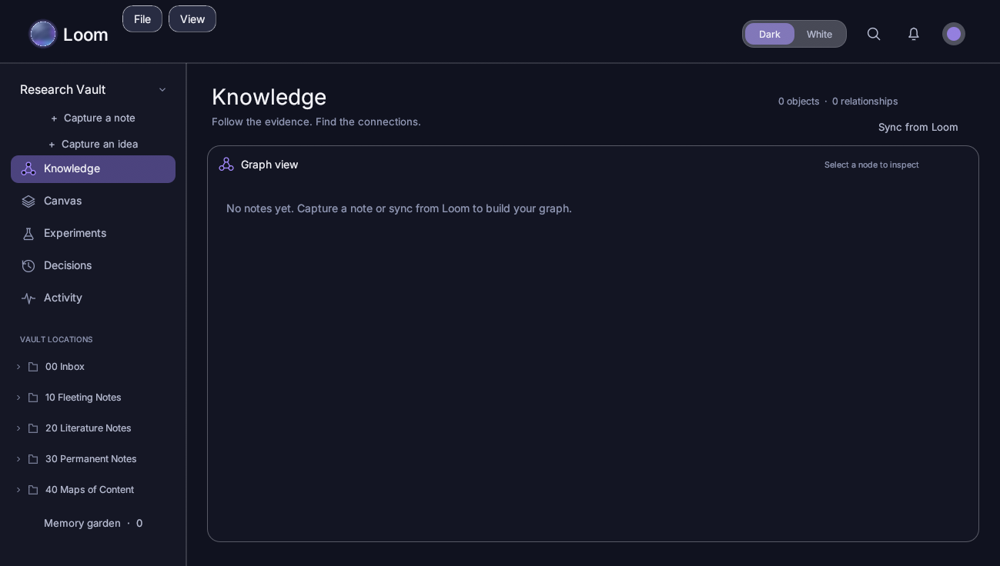
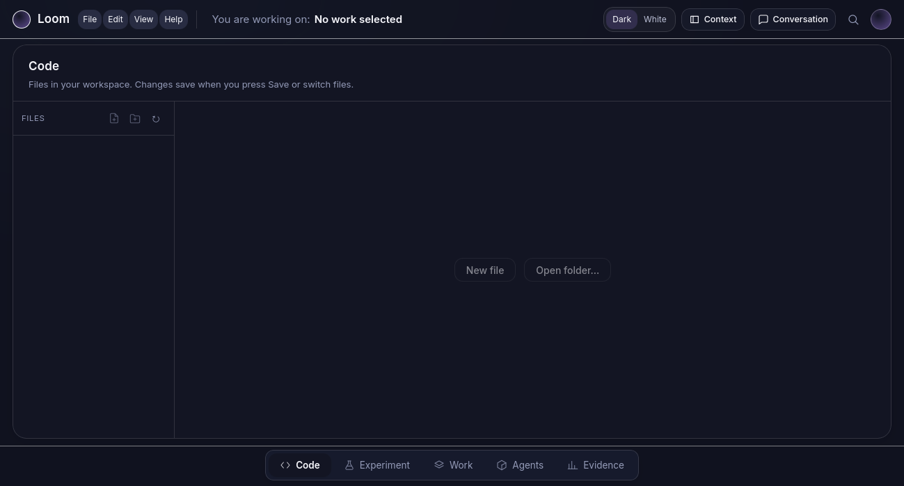
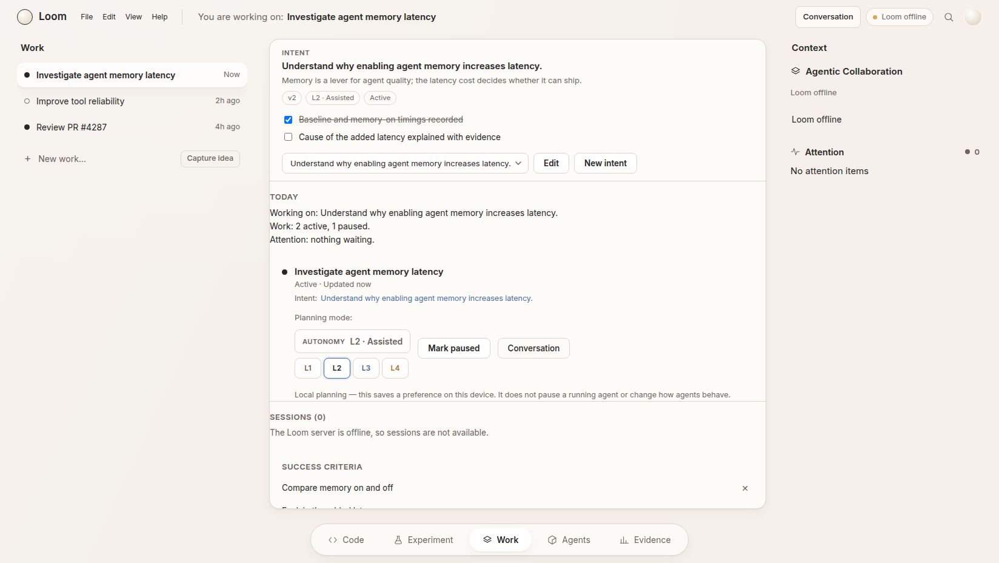
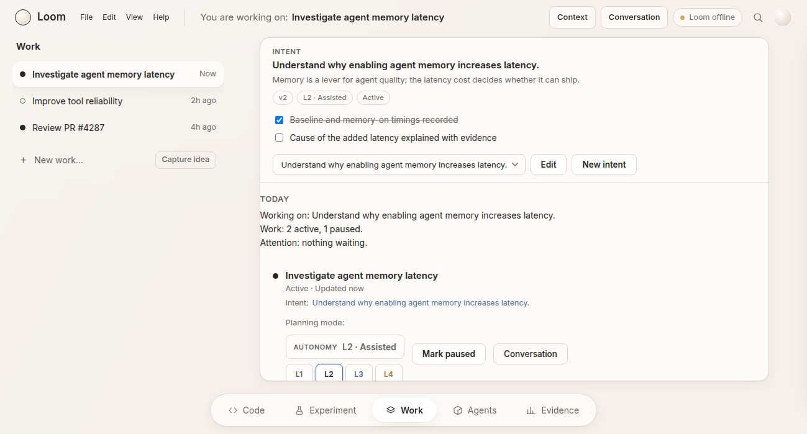

# Loom IDE — Tauri 2 prototype

> **Frontend cleanup:** sample research data, the native experiment demo/context
> preview, the empty Collaboration section and unused frontend bridges are no
> longer exposed. Native Activity is the working local journal; Canvas renders
> actual vault notes. Existing saved files are preserved. See
> [Frontend cleanup](docs/FRONTEND_CLEANUP.md).

> **Integrated hobby prototype:** Living Workbench now includes File/View menus,
> a local file editor using Tauri’s selected folder, and a read-only view of the
> same saved Tauri work/intents/experiments. Open the full Tauri tools from
> Workbench’s File menu; return through Tauri’s View → Living Workbench.
> Both original interfaces remain available. This currently uses two windows;
> vault and Tauri experiment formats have not been migrated or unified.
> See [native-app/README.md](native-app/README.md#integrated-workbench-surfaces).

## Merging the two concepts

This hobby project brings **Living Workbench** and the **Human-Centered
Development Environment** together around Loom. We want to keep what makes each
useful and combine them into one evolving experience.

Living Workbench contributes the sphere, Dark/White appearance, conversation,
knowledge graph, local notes, review bell and bottom navigation. The Tauri
environment contributes File/Edit/View menus, workspace files and editing,
structured work and intents, and the existing Loom session, agent, workflow and
artifact integrations.

Both projects remain in this repository: `native-app/` is the native eframe
workbench, while `src/` and `src-tauri/` form the Tauri app. They now share design
tokens, access to the selected local workspace, a view of saved work records,
and navigation that focuses the existing application instead of opening copies.

The merge is ongoing: there are still two windows, separate vault and work data
models, and incomplete Loom integrations. Sample-only and unfinished frontend
sections have been removed while preserving saved files. The
[Loom connection audit](docs/LOOM_CONNECTION_AUDIT.md) and
[frontend cleanup notes](docs/FRONTEND_CLEANUP.md) describe those boundaries.






The other screenshots in `docs/` preserve earlier design and verification states;
they are not all representations of the current interface. The render-check JSON
files record actual viewport dimensions, which take precedence over filenames.

## The shell

Three explicit rows, in normal flow, with no absolutely positioned
navigation:

- **Header (56px)** — brand and application menus, the current objective,
  labeled **Work** (compact widths), **Context**, and **Conversation**
  controls, search, the Loom reachability pill, and the avatar.
- **Main (`minmax(0, 1fr)`)** — the intent +
  work catalogue (300–328px), the center surface (floor ~520px when the
  side panes are present), and one right contextual pane (304–320px)
  with **Context** and **Conversation** tabs.
- **Footer (58px)** — the labeled mode switcher in normal flow:
  **Code · Experiment · Work · Agents · Evidence**. The footer provides the primary navigation.

Every long region owns its scrolling; headings live outside scrolling
bodies and never clip. The center never hides behind fixed navigation.

**One contextual surface.** Context (attention, session,
agent, tools, models, providers, artifacts, storage) and Conversation
share the right pane. Opening one tab or drawer closes the other; chat
is no longer a second left-column panel. An unsent message is saved as
you type, so it survives tab changes, closing the drawer, and restarting
the app. Drawers close with Escape, trap focus while open, and return
focus to the control that opened them. Drawers span only the main row;
the header and footer stay interactive so a pane can be swapped or
reopened without first dismissing it.

**Breakpoints.** At ≥1440px the right pane is a persistent column and
can be collapsed from the header. At 1100–1439px it becomes a labeled
drawer behind **Context** / **Conversation**. Below 1100px the intent + work catalogue also becomes a drawer behind
**Work**; the center uses the full width. Resizing from a wide window
does not pop the persistent inspector open as an unrequested modal, and
growing back restores the desktop column. Status text hides below
1320px and the avatar below 1140px, but every destination remains
available.

**Narrow components.** At a 330px container the selected-work summary
keeps its title unclamped (wrapping as needed) and stacks the planning
and state controls below the text. Titles never use
`word-break: break-all`; list titles wrap to at most two lines, while
the selected title is never clamped or hidden.

**Depth, not transparency.** The window is opaque — the desktop never
shows through. The sense of 3D comes from layering: a painted warm
backdrop with a light beam, translucent glass panels floating above it,
and one restrained shadow separating the layers. The water reflection
is kept as background atmosphere in **Experiment** overview only; in
Work and Code modes the background behind reading surfaces is flatter,
so text stays easy to read. (An earlier build made the window itself
transparent; that was a misunderstanding and was reverted.)

## Modes and how to reach them

- **Work** — the left panel holds the active intent above the work
  catalogue; there is no second catalogue in the center. The center shows
  the selected work in reading order: full title and state, the labeled
  planning preference with its supported local action, goal and editable
  success criteria, artifacts, evidence, then a collapsed supporting
  section for real Loom workflows and recent runs. Summary metadata is
  its own line (`Active · Updated now`, `Paused · Updated 2h ago`);
  autonomy appears once, inside the labeled planning select. The new-work
  form and **Capture idea** create real local work linked to the active
  intent. When there is no work, the empty state points back to the
  catalogue without inventing a selected item.
- **Experiment** — a list + detail view: question, hypothesis, arms,
  Run-arm (real weave calls against the Loom server), results, and a
  decision card once ≥2 arms are done. The luminous sphere (canvas 2D:
  radial gradients + fine flowing contour lines + water reflection) is a
  compact state indicator in the experiment sidebar, with a caption in
  plain words. The sphere exists only in Experiment, pauses while hidden,
  and respects reduced-motion preferences; water is atmosphere only in
  this view.
- **Code** — the default workspace is a blank canvas backed by a separate
  `Loom` folder in Documents. It lists only files in that folder, with no
  document opened automatically. Create files/folders or use **File → Open
  folder** to enter another folder's path; the selection is remembered.
  Files can be edited and saved. Changing files or closing the current file
  saves it first; an external modification stops the save and preserves the
  draft. **Reload file** explicitly discards a draft after confirmation.
  Saved notes from older versions remain available from File when present.
  Work, Context and Conversation open on demand in Code.
- **Agents** — the agents from `GET /v1/agents`: name, status dot,
  uptime, active sessions, message count. Empty ("No agents running")
  only when the server reports none.
- **Evidence** — what the claims rest on: experiment decisions made in
  this workspace. Empty ("No evidence yet") until a decision is made.
  The Loom server exposes no findings/traces API, so there is nothing
  else to show yet.
- **Application menus** — File, Edit, View and Help are in the top bar.
  View includes the scene's light, water, glass and sphere controls.
- **Artifacts** — available through **Browse workspace** in Work, the
  Artifacts destination from work and conversation cards, and the
  Documents tab. Artifacts is not a footer mode.

## What it is

- **Backend (Rust, `src-tauri/`)** — Tauri 2 commands (54):
  - Work: `get_work_items` / `add_work_item` / `set_work_status` /
    `set_work_autonomy` / `set_work_session` /
    `set_work_success_criteria` / `set_work_artifacts` — work items
    persist as structured JSON in `<app-data>/loom-ide/work.json`,
    like the existing eframe app. The store starts empty; work items
    come from the user creating them. Saves are atomic (temp file +
    fsync + rename); a corrupt file is moved aside, never overwritten.
  - Intents: `get_intents` / `create_intent` / `update_intent` /
    `set_intent_acceptance` / `set_active_intent` / `delete_intent` —
    an Intent is what the person wants, why, what "done" means
    (acceptance checklist), and how much freedom the system has.
    Persisted in `<app-data>/loom-ide/intents.json` with the same
    atomic-save and corrupt-file protection as work items. One intent
    owns many work items; the active intent is pinned at the top of
    the workspace. No work exists without an intent: creating work
    with no active intent auto-creates a one-line intent from its
    title. Work inherits its intent's autonomy, and a work item's
    autonomy can never be raised above its intent's level. Editing an
    intent's statement, why, or autonomy bumps its version and keeps
    the previous version in history; ticking acceptance criteria does
    not bump the version. An intent with work attached cannot be
    deleted until that work is moved or removed.
  - Experiments: `get_experiments` / `add_experiment` /
    `add_experiment_arm` / `set_experiment_arm_status` /
    `set_experiment_arm_result` / `choose_experiment_arm` /
    `clear_experiment_decision` — persisted in
    `<app-data>/loom-ide/experiments.json`. Arms run as real weave
    calls; a decision requires a finished arm with a real result.
  - `get_collaboration` — empty until the Loom server exposes live
    execution state. `get_attention` — experiment decisions waiting
    on the human (≥2 arms done, no winner picked yet).
  - `get_loom_status` — the real component check, `GET /v1/health`
    against localhost:5006 (async, via the raw HTTP client below).
    The plain `/health` route is a static stub and is not used.
  - Sessions/agents/chat: `list_sessions` / `create_session` /
    `list_agents` / `get_session_history` / `ask_loom` — a real
    `POST /v1/weave` on `http://localhost:5006` with `{"query": ...}`.
    The Rust HTTP client reads framing explicitly, including chunked
    responses from gRPC-gateway. The gateway encodes 64-bit integers
    as JSON strings; the backend parses them tolerantly. When the
    server cannot be reached, or answers without usable text, the
    command fails and the UI shows the error. Nothing invents a reply.
  - Loom server details: `get_session` / `list_tools` / `get_trace` /
    `get_agent` / `list_models` / `list_providers` / `switch_model` /
    `get_artifact` / `get_artifact_content` / `search_artifacts` /
    `get_artifact_stats` / `get_server_config` / `get_storage_status` —
    read-only server state (traces, tools, models, providers, artifact
    content with base64 decoding, server config and storage status).
    `get_trace`, `switch_model`, `get_artifact`, `get_artifact_content`
    and `search_artifacts` are not wired to the UI yet.
  - Workflows/artifacts: `list_workflows` / `execute_workflow` /
    `get_workflow_execution` / `list_workflow_executions` /
    `list_artifacts` (optionally scoped to one session). Workflow
    runs are blocking; the execute response's `result` is surfaced as
    evidence. Executions carry no work id on the server, so the list
    is workspace-global.
  - Workspace files: `get_workspace` / `open_workspace` /
    `list_workspace` / `list_directory` / `create_workspace_file` /
    `create_workspace_directory` / `read_file` / `write_file`. The default
    is Documents/Loom, independent of `~/.loom` and `LOOM_DATA_DIR`.
    Folder selection metadata is stored in app data, outside the content
    folder. Paths are canonicalized and contained; text reads/writes are
    limited to 1 MB. Writes preserve file permissions and reject changes
    made since the file was opened. No files are seeded or migrated.
- **Frontend (Vite + TypeScript, `src/`)** — no framework: plain
  TypeScript + CSS, chosen deliberately because the UI is a static,
  design-driven layout and hand-written DOM/CSS gives the closest
  control over the glass/transparency look with the smallest bundle.
  In `vite dev` (plain browser) the Loom calls go through the
  `/api/loom` dev proxy in `vite.config.ts`, which forwards to
  `http://localhost:5006`; work items fall back to localStorage. The
  same no-demo rule applies there: a failed call is an error, not a
  made-up reply.

### Truthfulness rules (the UI must not pretend)

- The status pill reports **server reachability only** — **Loom offline**,
  **Server reachable**, or **Connected to Loom** after a verified
  Loom-level response. It is never used as a provenance claim.
- There is no seed or demonstration data anywhere in the app. Empty
  states are honest: "No work yet", "No agents running",
  "Nothing needs a decision", "No evidence yet", "No artifacts yet",
  "No artifacts attached", "No evidence attached",
  "No success criteria recorded."
- Provenance is stated next to the content it describes: collaboration
  and attention panels say when they come from the Loom server, local
  experiment decisions say they were recorded by you, and any sample
  content would carry a visible **Sample** chip (the chips remain in the
  markup for that purpose; none ship with the app).
- The chat starts empty with a short hint. If the Loom server is not
  reachable, the chat shows a connection error ("Could not reach
  Loom: …") and keeps the failed text in the composer for retry. It
  never invents a demo reply.
- Work controls are **local planning labels**: "Planning mode" and
  "Mark paused" / "Mark active" save a preference on this device.
  A note beside them says they do not pause a running agent or change
  how agents behave. Execution controls that the server does not expose
  do not exist yet.
- Progress is stated as "Step 3 of 5" and "2 of 5 completed" — active
  work is never counted as completed.
- Decisions open an inspectable dialog (question, arms, results, and the
  record/change action) instead of existing only as passive rows or a
  four-second sphere tint. Escape closes only the top layer and returns
  focus to the decision that opened it; it does not also close the
  drawer behind it.
- Every active control performs its labeled action. A click that
  redirected to an unrelated mode was a defect and was fixed.
- A failed save shows a readable error beside the control; the
  control's previous value is restored.

### Type scale and tokens

- Body 14–15px, secondary 12–13px, section titles 16–18px,
  line height 1.4–1.5, 4px spacing base.
- Palette: app background `#F5F0EB`, text `#292725`, secondary
  `#77716D`, boundary `#DDD5D0`, focus/selection muted blue `#6A91CC`,
  amber `#D9A65F` for decisions.
- Panel radii 12–16px, control radii 6–8px, one restrained panel
  shadow, flat list rows with a quiet selection wash.
- **Window**: 1648×928 by default (the design's fidelity target),
  minimum 1024×640, opaque.

## Before / after (the 2026-11-11 redesign)

Before — the version Eduardo ran and screenshotted:





- The window was transparent in the original build, so the desktop
  showed through the IDE (fixed earlier; the current window is opaque).
- Work mode still duplicated context: the intent, a Today summary, and
  the selected work all lived in the center, while the catalogue sat in
  the left column. A Sessions list and the chat competed with the work.
- The original mode nav was absolutely positioned over content with
  104–110px of bottom padding as compensation; headings could clip.
- Work cards truncated titles, repeated autonomy outside its control,
  and could say "Now ago". The autonomy dial was bulky.
- A decision only tinted the sphere for a few seconds instead of
  opening inspectable detail.
- The water horizon ran behind reading surfaces in every mode.

After this pass:

- Opaque window; depth through layered paint, glass, and shadow.
- Three-row shell; a single labeled footer mode nav
  sharing one active state; headings never clip.
- Work mode: active intent + work catalogue left, selected-work detail
  center, and one contextual pane right — no duplicate catalogue,
  Today summary, or Sessions list in the center.
- Work summary: title on its own first row, metadata on its own line,
  controls below the text; "Updated now" / "Updated 2h ago"; autonomy
  once, in the labeled planning select; local-only planning is stated
  beside the control.
- Conversation lives in the right pane as a tab, not below the work
  list. Drafts and cached history survive tab and drawer changes.
- At <1440px the inspector is a drawer; at <1100px the catalogue joins
  it. Focus traps, Escape, return focus, a non-stacking drawer policy,
  and a resize transition that does not create an unexpected modal.
- Decisions open an inspectable dialog with real experiment arms and
  results; long explanations wrap and scroll within the dialog.
- 330px component behavior: selected titles never clamp or use
  `break-all`, and controls stack below the text.
- Water reflection only in Experiment overview; flat warm background
  behind reading surfaces; sphere only in Experiment, paused when
  hidden, reduced-motion aware.
- No seeds, demo replies, or test fixtures in the app. Empty states are
  honest, provenance is labeled, and a failed Loom call is a visible
  connection error.

## Run it (Ubuntu 24.04)

### 1. System dependencies

```bash
sudo apt update
sudo apt install -y libwebkit2gtk-4.1-dev build-essential curl wget file \
  libxdo-dev libssl-dev libayatana-appindicator3-dev librsvg2-dev \
  libgtk-3-dev pkg-config
```

### 2. Rust (via rustup) and Node.js 20+

```bash
curl --proto '=https' --tlsv1.2 -sSf https://sh.rustup.rs | sh -s -- -y
# then restart your shell, or: source ~/.cargo/env
node --version   # needs 20+
```

### 3. Run the app

```bash
npm install
npm run tauri dev
```

### 4. Build installers (.deb / .AppImage)

```bash
npm run tauri build
# bundles land in src-tauri/target/release/bundle/
```

### Frontend only (no Rust, in a browser)

The UI also runs in a plain browser with local persistence, for quick
visual iteration. The Loom calls go through the `/api/loom` dev proxy
to `http://localhost:5006`; start the Loom server first
(`looms serve --http-port 5006`) or the chat shows a connection error.

```bash
npm run dev      # http://localhost:1420
```

## Tests and automated checks

After the local hook is enabled, commits run the fast checks below.
GitHub Actions (`.github/workflows/ci.yml`) runs the full offline suite
on pushes and pull requests targeting `tauri-prototype`.

**On commit** — the pre-commit hook (`.githooks/pre-commit`) runs the
fast gates for the files you actually changed: `npm run build` when
frontend files changed, `cargo fmt --check` + `cargo check` when Rust
files changed. Docs-only changes pass straight through. One-time setup
per clone:

```bash
git config core.hooksPath .githooks
```

Bypass in a genuine emergency only (`git commit --no-verify`); CI still
runs on push.

**On push** — CI runs both jobs: frontend (`npm ci`, `npm run build`,
`npm test`) and backend (`cargo fmt --check`, `cargo clippy`, `cargo
check`, `cargo test`). Clippy currently reports without failing the
build: the tree has existing production style lints (including collapsible
`if let` blocks and `&PathBuf` signatures). Once those are fixed,
tighten it to `cargo clippy -- -D warnings`.

**Run the gates by hand:**

```bash
npm test                                   # frontend tests (vitest)
npm run build                              # typecheck + bundle
cargo test --manifest-path src-tauri/Cargo.toml --locked --lib   # Rust tests
cargo clippy --manifest-path src-tauri/Cargo.toml --locked
cargo fmt --check --manifest-path src-tauri/Cargo.toml
```

**What the tests cover.** Rust: the three stores (work, intent,
experiment) and their rules (version bumps and snapshots, the autonomy
dial's raise-needs-justification and intent ceiling, delete-refuses-
when-referenced, atomic save/load round trips, corrupt-file handling),
plus the Loom wire format (gateway-shaped JSON: camelCase keys, int64
as strings, bytes as base64) for every response struct. Frontend: the
`api.ts` pure helpers and the localStorage fallback, which mirrors the
core autonomy rules. Workspace tests cover real file/folder creation,
collisions, dotfiles, invalid names and destination containment in isolated
temporary directories. Test fixtures are never used as application data.

The browser fallback still differs from the backend in some cases: lowering
an intent does not yet tighten its work items, and a blank intent update
keeps the old statement instead of rejecting it. These are not parity
guarantees made by the current suite. DOM rendering and the pending UI race
fixes still need a checked-in end-to-end suite.

**UI verification for this redesign.** Browser layout and interaction
were checked with Playwright at 1648×928, 1441×900, 1440×900, 1439×900,
1366×768, 1299×699, 1281×800, 1280×800, 1200×700, 1100×700, 1099×700,
and 1024×640. No viewport produced horizontal overflow; the inspector
crossed from persistent column to drawer at 1440/1439, and the catalogue
crossed to a drawer at 1100/1099. Additional fixtures covered:

- zero work and zero intent;
- 20 work items (the catalogue scrolls independently);
- a 200-character selected title (no clamp, no `break-all`, no overflow)
  and a 330px component capture;
- 30 cached chat messages (the conversation log owns its scroll);
- a long attention/decision explanation (the dialog wraps, scrolls, traps
  focus, and returns focus on Escape);
- 125% scaling at a 1280×800 physical window (1024×640 CSS viewport).

The screenshots live in `docs/`; see `docs/screenshot-work-*.png`,
`docs/screenshot-code-1299.png`, and
`docs/screenshot-experiment-1299.png`.

The live gateway smoke test is ignored in normal runs because CI has no Loom
server. To run it against an existing server on localhost:5006:

```bash
cargo test --manifest-path src-tauri/Cargo.toml --locked --lib \
  gateway_tests::live_gateway_responses_parse -- --ignored --exact
```

It checks configuration, storage health, models, tools, providers, and session
detail when a session exists. Populated provider activation, trace shapes and
both artifact-content encoding layers have offline contract tests; the live
smoke test does not exercise workflow execution, chat, traces or artifact
content retrieval.

## Project layout

```
loom-ide-tauri/           # Tauri 2 prototype (current direction)
├── index.html            # three-row shell, panes, dialogs, drawers
├── src/
│   ├── main.ts           # app logic, panes, work detail, chat, modes
│   ├── api.ts            # Tauri invoke wrappers (+ browser fallback)
│   ├── api.test.ts       # frontend fallback tests
│   ├── app-menu.ts       # File / Edit / View / Help menus
│   ├── sphere.ts         # Experiment sphere + reduced-motion handling
│   └── style.css         # theme, shell, responsive panes, components
├── src-tauri/
│   ├── src/lib.rs        # Tauri commands, Loom HTTP client
│   ├── src/store.rs      # work/intent JSON persistence (starts empty)
│   ├── src/experiment.rs # experiment JSON persistence (starts empty)
│   ├── src/main.rs       # entry point
│   ├── tauri.conf.json   # window 1648×928, bundle id com.loom.ide
│   └── capabilities/default.json
├── docs/                 # design docs, experiments, validation captures
├── native-app/           # earlier native experiment (historical reference)
├── README.md
└── HOW_TO_OPEN.md        # how to run this prototype
```

## Status / known gaps

- The sphere is canvas 2D, not a 3D shader — it matches the reference's
  line-art look but is not a true 3D object.
- Code mode is a plain notes editor (no Monaco yet).
- The Loom server integration is real-or-error: real `POST /v1/weave`
  when the server runs, a visible connection error otherwise. The
  contracts were verified against the real Loom protos (see
  `docs/loom-integration.md`); the gateway encodes 64-bit integers as
  JSON strings and the backend parses them tolerantly.
- Artifacts are listed in Work detail and reachable through the
  Artifacts view (optionally scoped to the work's session); evidence
  shows experiment decisions. Collaboration steps are still empty until
  Loom exposes live execution state; attention items are the local
  experiment decisions waiting on the human.
- Workflow executions are workspace-global: the server attaches no
  work id to an execution, so per-work attribution is impossible from
  the API. Workflow runs are blocking (no streaming yet); long runs
  can hit the client's 180 s read timeout.
- No trace view: the server returns trace ids but `GetTrace` is
  unimplemented server-side. No experiment comparison statistics,
  no judges, no cost tracking yet.

## Historical note

An earlier direction — a single-file eframe/egui desktop app with an
Obsidian integration — is **historical**. Its build prompt,
`docs/05-craft-anything-build-prompt.md`, is retained only as a record
of that exploration; its stack lock (`eframe`/`egui`, dark Obsidian
styling) does not apply to this repository. The current direction is the
Tauri 2 prototype described above. The `native-app/` directory is an
earlier native experiment kept for reference; it is not part of the
current build. Do not run `cargo build` at the repository root expecting
either historical app.

## License

Prototype — no license chosen yet.

### Shared appearance

Both interfaces use `design-tokens.json` for Dark/White semantic colors and
12px control / 20px panel radii. `src/theme.ts` applies those tokens to the
web interface; `native-app/src/visual.rs` reads the same file at compile time.
Each interface retains its existing theme preference storage. Layout, commands,
file tools, vault records and Loom integrations remain available.
