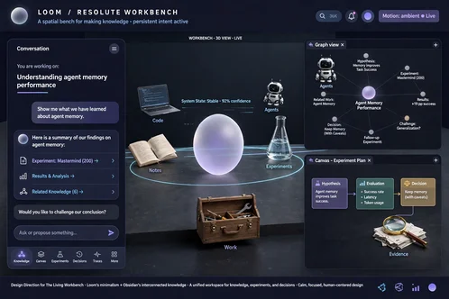

# Approved unified workbench composition

Eduardo approved this reference on 2026-11-14 in the project chat.

Use the image as a composition and object-language reference for the authorized fold:
- One application window: conversation on the left, existing Unity bench in the center, Knowledge Graph/Canvas on the right where the existing layout can support them.
- Preserve Dark/White and existing theme preferences. The image does not mandate replacing the current palette.
- Keep the central sphere and existing interactions.
- Physical forms: Notes notebook, Code laptop, Work toolbox, Experiments flask, Agents robot, Evidence magnifying glass with documents.
- Render actual vault/server data only. Do not copy the image's example conversation, tasks, numbers, graph nodes or confidence claims.
- Preserve the fold's safety rules and phase order. Finish and verify the data layer and Knowledge functionality before optional composition polish; record structural layout work as deferred if necessary.

This reference does not mean the pictured interface is already implemented or verified. It does not authorize new dependencies, data migration, file deletion, push, or a decision on Q2.

> **2026-11-17 amendment**: Eduardo removed the Knowledge Graph/Canvas side
> panel from the Spatial view. Spatial is now the conversation on the left
> and the Unity bench filling the remaining width; Knowledge is reachable
> only through its own full view (`#view-knowledge`). The pictured
> "Knowledge Graph/Canvas on the right" composition no longer applies.
