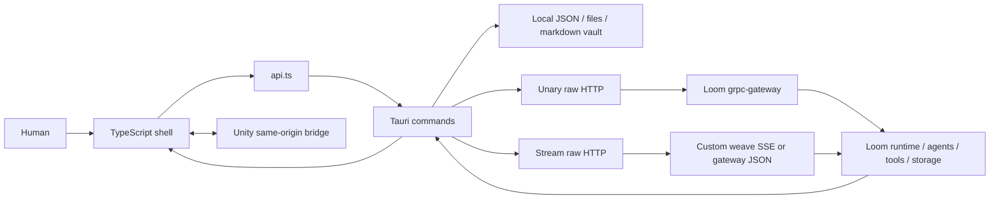

# 04 — Technical architecture audit

## Current boundaries and data flow

The active shell is `index.html` + `src/main.ts` (7,477 lines), vanilla TypeScript with Monaco. `src/api.ts` (1,391 lines) selects Tauri invokes or limited browser fallbacks. Rust `lib.rs` (2,319 lines) registers 139 commands, owns local stores and raw HTTP; `loom_http.rs`, `loom_tasks.rs` and `loom_stream.rs` extend that boundary. Unity runs in a same-origin iframe through `src/spatial.ts` and `public/spatial-player.js`. `native-app/` is retained/tested historical source; the second window is retired in the active shell, despite the root README.

This is multiple stores with explicit links, not one unified runtime database. That can be sound if identity/provenance are durable and capability boundaries are honest.

| State | Authority and persistence | Audit result |
|---|---|---|
| Work/intents/experiments | App-data JSON; mutexes; atomic temp-write/fsync/rename | Passing validation, inheritance, corruption/restart unit tests; runtime permission enforcement absent |
| Workspace/edit buffer | Selected root in workspace.json; filesystem is source of truth; unsaved buffer in UI | Containment, 1 MB limit, binary rejection and external-edit guard tested; hostile concurrent-process races not stress-tested |
| Knowledge | Build-checkout markdown vault; .loom ledger/history/pending journal | Strong local safety tests; portable path, watcher blind spots and layout persistence gaps QC-16/18/19 |
| Sessions/agents/artifacts/workflows | Loom configured stores and runtime registry | Real API reads; mutations/streams vary by contract; metadata wrappers do not establish execution |
| Execution → work and experiment → work | Frontend Maps | Lost on restart, QC-14; streaming workflows also use current selection, QC-13 |
| Chat/drafts/appearance | WebView localStorage | Draft recovery exists; reply cache loses trace metadata; browser fallback is a separate persistence path |
| Sphere | Frontend derived reachability/attention/in-flight state forwarded to Unity | Genuine UI events, not an authoritative multi-client runtime state; false completion inherits stream defects |

## Contract integrity

Confirmed silent/near-silent defects are tracked in QC-03 through QC-14 and QC-15/18. The broad generic `Value` wrappers default missing lists to empty arrays and server fields to empty strings. This is appropriate only for truly optional protobuf fields; applying it to required envelopes masks contract mismatch. Use per-endpoint envelope validation, reusing existing typed serde patterns rather than adding a new service framework.

Important positive evidence: `de_i64` accepts string/numeric gateway integers; model/tool aliases preserve camelCase fields; fractional costs remain floating point; artifact bytes/base64 and content encoding have vectors/rejection tests; URL path/query values are percent-encoded. The live gateway smoke exercises current config/storage/models/tools/providers/session parsing. JavaScript numbers still cannot precisely represent arbitrary values above 2^53−1 even after a Rust i64 is serialized; current epochs are safe, extreme timestamps/sizes need a bounded UI contract. This boundary was reviewed, not demonstrated as a present user-data failure.

Sessions/executions use limit=500 and artifacts limit=200; source UI cap notices exist. No multi-page traversal was demonstrated. List RPC offset/page semantics must be tested before treating these as complete catalogues. Unknown enums, absent envelope fields and application-failure booleans require failure fixtures, not empty-success defaults.

## Reliability and coupling

The UI contains both presentation and long-running orchestration in global mutable state. Request origin is captured correctly on unary chat/arm paths, but not workflow-stream completion; artifact searches lack request generations. Session subscription cleanup is missing while task boards already contain a reusable cancellation pattern. These are focused repairs, not evidence that the whole app should be rewritten.

The raw unary HTTP client has response-size bounds, status-before-JSON errors, percent encoding and GET-only retry. It deliberately does not replay POSTs. The stream implementation needs HTTP framing/protocol/terminal tests and a bounded event size; its tests currently validate only start arguments and unknown cancellation IDs. `LOOM_ADDR` is parsed using unwrap, accepts non-loopback numeric addresses and has no TLS/auth contract. Invalid hostname/address input can panic a worker instead of returning a connection error; valid remote operation is outside the stated local profile. Add a checked address parse when repairing the connection boundary (QC-02), without inventing remote support.

## Maintainability, dependency and build assessment

Installed packages are Tauri APIs, fonts and Monaco plus existing TypeScript/Vite/Vitest tooling; no React is used or needed. Monaco is already approved in DECISIONS. The build passes but the entry bundle is large (see build log); startup/per-frame budgets were not measured. Split by responsibility only when repairing the relevant orchestration; a broad module rewrite would obscure contract fixes.

CI covers frontend and Tauri; native/Unity and real gateway workflows are not a required end-to-end CI gate. Source-string/DOM unit assertions establish shell structure, not a running WebView. A meaningful small transport/handler regression suite is higher value than more static layout assertions.

No production refactor, deletion or dependency change is proposed as a prerequisite. Keep local-work migration read-only by default, keep Q2 deferred, and preserve the sphere and current shell.
